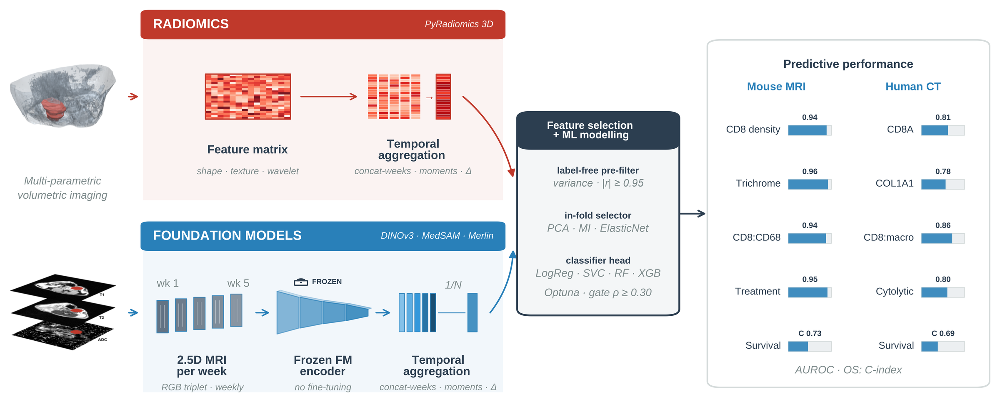

# Foundation-model imaging biomarkers for pancreatic cancer

Code for the paper *Foundation-model imaging biomarkers for pancreatic cancer: cross-species
discovery of conserved tumour biology in mouse MRI and human CT* (Yu G, Zhang Z, et al.).

The same pipeline is applied separately to two cohorts: longitudinal 9.4 T MRI of mice bearing
orthotopic KPC-derived tumours, and abdominal CT from the CPTAC-PDA cohort. A frozen pretrained
encoder (DINOv3, MedSAM or EfficientNet-B0) embeds three-slice stacks from the tumour region, the
stack embeddings are pooled into one vector per scan (and, in mice, aggregated over weekly scans),
and a classical classifier is selected and evaluated under grouped cross-validation against
histology in mice or proteogenomic measurements in patients. Overall survival in patients is
modelled as a censored outcome. The two arms share no features, weights or labels.



## Layout

```
configs/
  endpoints.yaml        encoder, pooling and aggregation of each reported endpoint
  paths.example.yaml    template for local data paths
pdacfm/
  features/             encoders, patch-token pooling, MRI and CT preprocessing, weekly aggregation
  labels/               endpoint definitions for each arm
  models/               feature pre-filter, selector and classifier search, survival model
  stats/                bootstrap intervals, Spearman correlation, multivariable Cox model
scripts/                command-line entry points
docs/pipeline.png       pipeline overview (Fig. 1B of the paper)
```

## Installation

The environment is managed with [uv](https://docs.astral.sh/uv/). Embedding extraction needs a
CUDA GPU.

```bash
uv sync --extra imaging   # modelling only: uv sync
```

`uv.lock` pins every package, including Python 3.11 and PyTorch 2.7.0. The `imaging` extra adds
PyTorch, timm, segment-anything and the image I/O libraries. DINOv3 and EfficientNet-B0 weights
are downloaded through timm; MedSAM needs the `medsam_vit_b.pth` checkpoint released by the
[MedSAM authors](https://github.com/bowang-lab/MedSAM).

## Data

Human CT scans and tumour annotations are public in The Cancer Imaging Archive (collection
CPTAC-PDA). Protein and RNA measurements are public in cBioPortal (study `paad_cptac_2021`).

Copy `configs/paths.example.yaml` to `configs/paths.yaml` and point it at your data. The
expected columns of the mouse pathology table and the human scan table are listed at the top
of `pdacfm/labels/mouse.py` and `pdacfm/labels/human.py`.

## Usage

Extract the embeddings named in `configs/endpoints.yaml`, then fit the endpoints.

```bash
# Mouse
uv run scripts/extract_mouse_embeddings.py --encoder dinov3_s --streams t1t2adc --pooling msc
uv run scripts/run_mouse.py --endpoint cd8

# Human
uv run scripts/build_ct_roi.py
uv run scripts/extract_ct_embeddings.py --encoder dinov3_l --pooling attn
uv run scripts/extract_ct_embeddings.py --encoder medsam
uv run scripts/run_human.py --endpoint all
uv run scripts/run_human_survival.py
```

Each run writes `summary.json` and the out-of-fold predictions to the results directory set in
`configs/paths.yaml`. Model selection and evaluation are described in the docstring of
`pdacfm/models/classification.py`.

## License

MIT. See [LICENSE](LICENSE).
